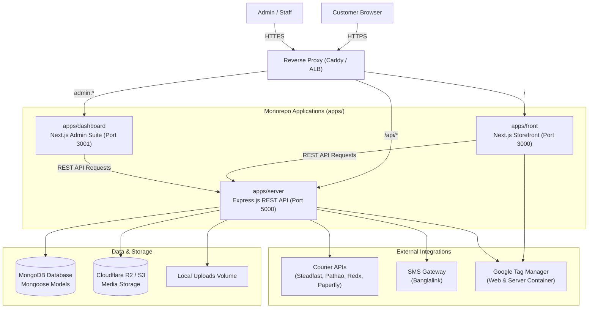

# System Architecture — Oneself E-Commerce Platform

The **Oneself Platform** is a scalable, multi-tier omnichannel e-commerce solution architected as a **Turborepo + pnpm monorepo**. It unites a high-performance customer storefront, an operations-heavy admin dashboard, and a feature-complete backend API.

---

## 🏛 High-Level Architecture Diagram

---

## 📦 Application Tier Breakdown

### 1. Customer Storefront (`apps/front`)
- **Framework:** Next.js 14 (App Router)
- **UI & Styling:** Tailwind CSS, Radix UI primitives, Lucide Icons, Framer Motion
- **State Management:** Redux Toolkit & Redux Persist (cart, user session)
- **Port:** `3000`
- **Responsibilities:**
  - Product catalog browsing, filtering, search, and detail pages.
  - Cart, checkout flows, and guest/registered order placement.
  - Real-time order tracking and warranty claim submissions.
  - Server-side and client-side Google Tag Manager (GTM) event dispatching.

### 2. Admin & Operations Dashboard (`apps/dashboard`)
- **Framework:** Next.js 14 (App Router)
- **UI & Data Handling:** TanStack Table, Tailwind CSS, Lucide Icons, Jodit Rich Text Editor
- **State Management:** Redux Toolkit & Redux Persist with JWT-based Auth Guards
- **Port:** `3001`
- **Responsibilities:**
  - Order processing, status updates, invoice printing, and delivery dispatch.
  - Product catalog management, inventory adjustments, and image upload manager.
  - Coupon management with date and usage constraint validations.
  - Warranty claim verification, media proof inspection, and claim resolution.
  - Role-Based Access Control (Super Admin, Admin, Staff permissions).

### 3. Backend REST API (`apps/server`)
- **Runtime & Framework:** Node.js, Express.js, TypeScript
- **Database Layer:** MongoDB with Mongoose ODM
- **Port:** `5000`
- **Responsibilities:**
  - Authentication (JWT access & refresh tokens with secure HTTP-only cookies).
  - Order lifecycle management and multi-courier API integrations.
  - Fraud detection scoring across Steadfast courier history.
  - Automated cron jobs (cart cleanup, token rotation, background tasks).
  - Storage routing (Cloudflare R2, AWS S3, or local disk uploads).

---

## 🚚 External Logistics & Gateway Integrations

1. **Courier Integrations:**
   - **Steadfast:** Parcel creation, status webhooks, and customer fraud-checking scorecards.
   - **Pathao:** Automated order dispatch, city/zone mapping, and consignment tracking.
   - **Redx & Paperfly:** Supported secondary courier channels.
2. **SMS Notification Gateway:**
   - **Banglalink Corporate SMS:** Automated OTP verification, order placement confirmation, and status notifications.
3. **Analytics & Server-Side Tagging:**
   - Dedicated GTM Server Container and Web Container templates for full funnel tracking without ad-blocker loss.
