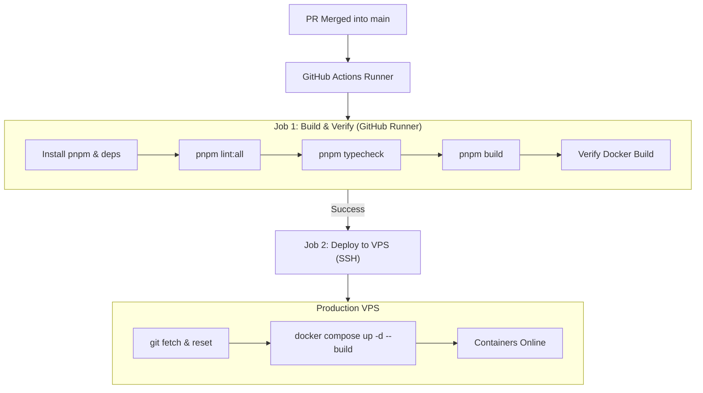

# Production Deployment & CI/CD Guide — Oneself Platform

This document outlines deployment strategies and the automated **GitHub Actions CI/CD pipeline** for the **Oneself Platform**.

---

## 🚀 Automated CI/CD Pipeline (GitHub Actions)

The repository includes an automated pipeline in [`.github/workflows/deploy.yml`](../.github/workflows/deploy.yml) that triggers whenever code is merged into `main` (or `master`).



### GitHub Secrets Required

Navigate to your repository on GitHub: **Settings ➔ Secrets and variables ➔ Actions ➔ New repository secret** and add:

| Secret Name | Description | Example | Required / Optional |
|---|---|---|---|
| `VPS_HOST` | Public IP or domain name of your VPS | `192.0.2.1` or `vps.oneselfbd.com` | **Required** |
| `VPS_USERNAME` | SSH user with docker execution permissions | `root` or `ubuntu` | **Required** |
| `VPS_PASSWORD` | Password for the SSH user (password authentication) | `YourStrongVpsPassword123!` | **Required** |
| `VPS_SSH_PORT` | SSH port | `22` | *Optional* (defaults to `22`) |
| `VPS_PROJECT_PATH` | Path where the repo is cloned on the VPS | `/opt/oneself` | *Optional* (defaults to `/opt/oneself`) |

> [!NOTE]
> Ensure that `/etc/ssh/sshd_config` on your VPS permits password authentication (`PasswordAuthentication yes`). If using a non-root user (e.g. `ubuntu`), add them to the `docker` group (`sudo usermod -aG docker $USER`) so Docker commands run without `sudo` prompts.

---

## ⚖️ Architecture Choice: Docker vs. PM2

| Metric | 🐳 Docker (Docker Compose) [RECOMMENDED] | ⚡ PM2 (Bare-Metal) |
|---|---|---|
| **Whole-Stack Support** | Manages all 5 services: `front`, `dashboard`, `server`, `mongo`, `caddy`. | Only runs Node processes (`front`, `dashboard`, `server`). MongoDB & Caddy must be installed manually. |
| **Host Isolation** | Completely isolated containers. Zero host package conflicts. | Shared host OS. Requires Node, pnpm, Python, GCC on host. |
| **Build Stability** | Built on GitHub Actions, running pre-compiled standalone artifacts. | Running `pnpm install` or builds on host risks RAM exhaustion (OOM). |
| **SSL & Routing** | Automated with Caddy in `docker-compose.prod.yml`. | Manual Nginx/Caddy server block configuration on host. |
| **Resource Usage** | Slight daemon overhead (~150MB total). | Slightly lower memory usage (~50MB lower). |
| **Best Suited For** | Production VPS with ≥ 2GB RAM. | Ultra-budget VPS with ≤ 1GB RAM. |

**Verdict:** **Docker Compose is strongly recommended**. It provides predictable, reproducible deployments with zero host pollution and handles both application and database orchestration in a single command.

---

## 🖥 Deployment via Docker Compose (Recommended)

1. **Clone repository on VPS:**
   ```bash
   sudo git clone <repo-url> /opt/oneself
   sudo chown -R $USER:$USER /opt/oneself
   cd /opt/oneself
   ```

2. **Configure production environment:**
   Create an `.env` file in `deployment/vps/.env`:
   ```env
   DOMAIN_NAME=yourdomain.com
   DASHBOARD_DOMAIN=admin.yourdomain.com
   ACME_EMAIL=admin@yourdomain.com
   DB_URL=mongodb://host.docker.internal:27017/oneself
   ACCESS_TOKEN_SECRET=long_random_jwt_access_secret
   REFRESH_TOKEN_SECRET=long_random_jwt_refresh_secret
   ```

3. **Start stack manually or let GitHub Actions deploy:**
   ```bash
   cd deployment/vps
   docker compose -f docker-compose.prod.yml up -d --build
   ```

4. **Verify container health:**
   ```bash
   docker compose -f docker-compose.prod.yml ps
   ```

---

## ⚡ Deployment via PM2 (Alternative)

If using PM2 on a low-resource server without Docker:

1. **Install PM2 globally on VPS:**
   ```bash
   npm install -g pm2
   ```

2. **Build and launch with ecosystem configuration:**
   ```bash
   pnpm install
   pnpm build
   pm2 start ecosystem.config.cjs
   pm2 save
   pm2 startup
   ```
