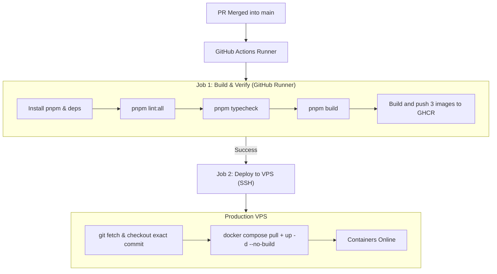

# Production Deployment & CI/CD Guide — Oneself Platform

This document outlines deployment strategies and the automated **GitHub Actions CI/CD pipeline** for the **Oneself Platform**.

---

## 🚀 Automated CI/CD Pipeline (GitHub Actions)

The repository includes an automated pipeline in [`.github/workflows/deploy.yml`](../.github/workflows/deploy.yml) that triggers whenever code is merged into `main` (or `master`).



### GitHub Secrets Required

Navigate to your repository on GitHub: **Settings ➔ Secrets and variables ➔ Actions ➔ New repository secret** and add:

| Secret Name | Description | Example | Required / Optional |
|---|---|---|---|
| `VPS_HOST` | Public IP or domain name of your VPS | `192.0.2.1` or `vps.oneselfbd.com` | **Required** |
| `VPS_USERNAME` | SSH user with docker execution permissions | `root` or `ubuntu` | **Required** |
| `VPS_PASSWORD` | Password for the SSH user (password authentication) | `YourStrongVpsPassword123!` | **Required** |
| `VPS_SSH_PORT` | SSH port | `22` | *Optional* (defaults to `22`) |
| `VPS_PROJECT_PATH` | Path where the repo is cloned on the VPS | `/opt/oneself` | *Optional* (defaults to `/opt/oneself`) |

> [!NOTE]
> Ensure that `/etc/ssh/sshd_config` on your VPS permits password authentication (`PasswordAuthentication yes`). If using a non-root user (e.g. `ubuntu`), add them to the `docker` group (`sudo usermod -aG docker $USER`) so Docker commands run without `sudo` prompts.

### Frontend build-time environment

Create two multiline **repository variables** under **Settings → Secrets and variables → Actions → Variables**. Repository Secrets with the same names are also supported; Variables take precedence when both exist. Use Secrets for files containing private server-side settings:

| Actions variable or secret | Contents |
|---|---|
| `FRONT_ENV_PRODUCTION` | Full production dotenv contents for `apps/front`, based on `apps/front/.env.example` |
| `DASHBOARD_ENV_PRODUCTION` | Full production dotenv contents for `apps/dashboard`, based on `apps/dashboard/.env.example` |

For example, `FRONT_ENV_PRODUCTION` can contain:

```dotenv
NEXT_PUBLIC_FRONT_NODE_ENV=production
NEXT_PUBLIC_FRONT_API_BASE_URL=https://oneselfbd.com
NEXT_PUBLIC_FRONT_TRACKING_API_URL=https://your-tracking-host/api/v1/events
```

Storefront public variables use the `NEXT_PUBLIC_FRONT_` prefix; dashboard variables keep their existing names. Update existing `FRONT_ENV_PRODUCTION` contents to use the new names. Optional storefront settings are `NEXT_PUBLIC_FRONT_GTM_ID` and `NEXT_PUBLIC_FRONT_SX21_PRODUCT_ID`.

For the dashboard, include the production API URL, client URL, main domain, `/admin` base path, and the other settings from its example file. Paste actual multiline dotenv text, without wrapping the entire file in quotes.

Both the verification build and the image workflow require these configurations and mounts each as the application's `.env.production` only during `next build`, using [Docker BuildKit secret mounts](https://docs.docker.com/build/ci/github-actions/secrets/). The file is excluded from the Docker build context. A content hash invalidates the build cache when configuration changes.

`NEXT_PUBLIC_*` values are [embedded in browser JavaScript at build time](https://nextjs.org/docs/app/guides/environment-variables). They remain public even when supplied through GitHub Secrets. Keep database credentials and private API tokens out of these values. Changing the VPS `.env` cannot change these baked values; update the GitHub variable or secret and rerun the deployment workflow to publish and deploy a rebuilt image.

For a local frontend image build, pass the same file and its hash explicitly:

```bash
docker build -f apps/front/Dockerfile \
  --secret id=frontend_env,src=apps/front/.env.production \
  --build-arg FRONTEND_ENV_HASH="$(sha256sum apps/front/.env.production | cut -d ' ' -f 1)" \
  -t oneself-front:local .
```

### Image builds and registry access

GitHub Actions builds `server`, `front`, and `dashboard` on separate runners after verification succeeds. Images are published as `ghcr.io/<owner>/<repository>-<app>:<commit-sha>` using the workflow's `GITHUB_TOKEN`, following [GitHub's registry publishing workflow](https://docs.github.com/en/actions/tutorials/publish-packages/publish-docker-images). Repository names are lowercased for GHCR.

The VPS authenticates with the deployment job's temporary token, pulls all images, and runs Compose with `--no-build`. Registry credentials are removed at the end of the SSH session. No additional registry secret is needed. GitHub Actions must be allowed to write packages; if packages already exist, grant this repository Actions access in each package's settings.

The server Dockerfile runs `tsc`, which does not load application configuration. Server environment values are supplied by Compose through `env_file: .env` from `deployment/vps/.env` when the container starts; database credentials and JWT secrets are not baked into the server image.

Images target `linux/amd64`; the VPS must use that architecture. For an ARM VPS, change the build platform before deploying. Next.js public environment values are baked into the images during the GitHub build, so production frontend configuration must be available in the build context rather than only in the VPS `.env`.

The deployment checks out the exact built commit and saves the successfully deployed repository and tag in `deployment/vps/.env.images`. Builds and dependency installation no longer run on the VPS.

---

## ⚖️ Architecture Choice: Docker vs. PM2

| Metric | 🐳 Docker (Docker Compose) [RECOMMENDED] | ⚡ PM2 (Bare-Metal) |
|---|---|---|
| **Whole-Stack Support** | Manages `front`, `dashboard`, `server`, and MongoDB; Caddy runs on the host. | Only runs Node processes (`front`, `dashboard`, `server`). MongoDB & Caddy must be installed manually. |
| **Host Isolation** | Completely isolated containers. Zero host package conflicts. | Shared host OS. Requires Node, pnpm, Python, GCC on host. |
| **Build Stability** | Built on GitHub Actions, running pre-compiled standalone artifacts. | Running `pnpm install` or builds on host risks RAM exhaustion (OOM). |
| **SSL & Routing** | Handled by the existing Caddy service on the VPS. | Manual Nginx/Caddy server block configuration on host. |
| **Resource Usage** | Slight daemon overhead (~150MB total). | Slightly lower memory usage (~50MB lower). |
| **Best Suited For** | Production VPS with ≥ 2GB RAM. | Ultra-budget VPS with ≤ 1GB RAM. |

**Verdict:** **Docker Compose is strongly recommended**. It provides predictable, reproducible deployments with zero host pollution and handles both application and database orchestration in a single command.

---

## 🖥 Deployment via Docker Compose (Recommended)

Production Compose uses the existing Caddy service on the VPS. It publishes only loopback ports:

| Application | Host Caddy upstream |
|---|---|
| Storefront | `127.0.0.1:3000` |
| Dashboard | `127.0.0.1:3001` |
| API | `127.0.0.1:5000` |

Keep ports 80 and 443 assigned to host Caddy. Configure its existing routes to use these upstreams. The deployment's `--remove-orphans` removes the previous Compose Caddy container. Its certificate volumes are retained. The repository's `deployment/vps/Caddyfile` is a legacy container configuration and is not loaded by production Compose.

1. **Clone repository on VPS:**
   ```bash
   sudo git clone <repo-url> /opt/oneself
   sudo chown -R $USER:$USER /opt/oneself
   cd /opt/oneself
   ```

2. **Configure production environment:**
   Create an `.env` file in `deployment/vps/.env`:
   ```env
   DOMAIN_NAME=yourdomain.com
   DASHBOARD_DOMAIN=admin.yourdomain.com
   ACME_EMAIL=admin@yourdomain.com
   REVALIDATE_SECRET=long_random_shared_cache_secret
   ACCESS_TOKEN_SECRET=long_random_jwt_access_secret
   REFRESH_TOKEN_SECRET=long_random_jwt_refresh_secret
   ```

3. **Let GitHub Actions deploy on push to `main` or `master`.** For a manual deployment, first select an already published image set:
   ```bash
   cd deployment/vps
   export IMAGE_REPOSITORY=ghcr.io/owner/repository
   export IMAGE_TAG=full_commit_sha
   # Required for private packages: use a token with read:packages access.
   # docker login ghcr.io --username YOUR_GITHUB_USERNAME
   docker compose -f docker-compose.prod.yml pull
   docker compose -f docker-compose.prod.yml up -d --no-build
   ```

   After an automated deployment, reuse its saved image selection with:
   ```bash
   docker compose --env-file .env --env-file .env.images -f docker-compose.prod.yml up -d --no-build
   ```

4. **Verify container health:**
   ```bash
   docker compose --env-file .env --env-file .env.images -f docker-compose.prod.yml ps
   ```

---

## ⚡ Deployment via PM2 (Alternative)

If using PM2 on a low-resource server without Docker:

1. **Install PM2 globally on VPS:**
   ```bash
   npm install -g pm2
   ```

2. **Build and launch with ecosystem configuration:**
   ```bash
   pnpm install
   pnpm build
   pm2 start ecosystem.config.cjs
   pm2 save
   pm2 startup
   ```

### Server startup troubleshooting

The Express image intentionally starts in `/app/apps/server`, with the compiled entry point at `dist/server.js`. The workspace dependency paths must remain intact. Its layout differs from the Next.js standalone images.

Production logs are available through `docker logs --tail 100 oneself-server-prod`. If MongoDB cannot be reached, startup reports the error and exits so Compose can restart the container. The HTTP listener starts only after a database connection succeeds. The production server health check probes `/server-api`, and the automated deployment waits for readiness.

Production Compose runs MongoDB 8.0 on a private internal network shared only with the API. It publishes no database port and needs no MongoDB UFW rule. A single MongoDB instance runs as the sole member of `rs0`, supporting application transactions. The `mongodb-init` job initializes fresh installations and waits for a writable primary before the API starts. Existing `mongodb_data` and `mongodb_config` volumes are preserved. Compose sets both `DB_URL` and `MONGODB_URI` to `mongodb://mongodb:27017/oneself?replicaSet=rs0`, overriding old host connection strings in `.env`. Do not use `docker compose down -v` unless you intend to delete the database.

### Single-node replica-set operation

Only one MongoDB server runs on the VPS. Replica-set mode enables transactions; there is no secondary copy or failover. Keep regular backups. The initializer leaves an existing single-member `rs0` unchanged and checks that it becomes primary.

```bash
docker compose -f docker-compose.prod.yml up -d --wait --wait-timeout 600
docker compose -f docker-compose.prod.yml logs mongodb-init
docker compose -f docker-compose.prod.yml exec mongodb mongosh --quiet --eval 'printjson(rs.status().members.map(m => ({name: m.name, state: m.stateStr, health: m.health})))'
```

Expect only `mongodb:27017` with state `PRIMARY`. If the previous three-member configuration was already deployed, reduce that replica set to the original `mongodb:27017` member while the old members are still running, before applying this Compose change. The initializer deliberately refuses to overwrite a different existing membership or force a reconfiguration. Removing container definitions does not remove their membership from MongoDB.

### Moving existing host MongoDB data

The new volume starts empty; host data is not automatically imported. Keep the host database intact until migration is verified. Schedule a maintenance window and stop application writes before taking the dump. With compatible MongoDB Database Tools installed on the VPS:

```bash
cd /opt/oneself/deployment/vps
# Export IMAGE_REPOSITORY and IMAGE_TAG first, or load the deployed .env.images.
# Add REVALIDATE_SECRET to .env before running Compose (openssl rand -hex 32).
docker compose -f docker-compose.prod.yml stop server
mongodump --uri='mongodb://127.0.0.1:27017/oneself?directConnection=true' --archive=oneself.archive.gz --gzip
docker compose -f docker-compose.prod.yml up -d mongodb
docker compose -f docker-compose.prod.yml run --rm mongodb-init
docker compose -f docker-compose.prod.yml exec -T mongodb mongorestore --uri='mongodb://mongodb:27017/oneself?replicaSet=rs0' --archive --gzip < oneself.archive.gz
docker compose -f docker-compose.prod.yml up -d --wait
docker compose -f docker-compose.prod.yml logs --tail 50 server
```

Adapt the dump URI if the host database requires credentials. Restore into the fresh database before starting the API. Verify your products, users, and orders before retiring host MongoDB. Keep the dump outside version control. The container database uses no authentication and is isolated to the private database network; do not publish its port or attach untrusted containers to that network.

### Revalidate the storefront from the dashboard

Set a strong `REVALIDATE_SECRET` in the VPS `.env`; Compose passes it to the dashboard and storefront at runtime. Remove the old `NEXT_PUBLIC_REVALIDATE_SECRET` from dashboard build configuration. For local development, set the same server-only secret in both apps' environment files.

Signed-in admins and staff can click **Revalidate storefront** in the dashboard header. The dashboard verifies their token through the API and sends an authenticated internal request to the storefront. Existing tag-based updates use the same protected endpoint. Full revalidation invalidates the root layout and its cached data so pages regenerate when next visited; it does not pre-render every page or purge external CDN/browser caches. Errors are shown in the dashboard, and the button is disabled while running.

`MAIN_DOMAIN` must be a hostname such as `oneselfbd.com`, without `https://` or a port, because it is used as a cookie domain. Production Compose defaults it to `DOMAIN_NAME`.
